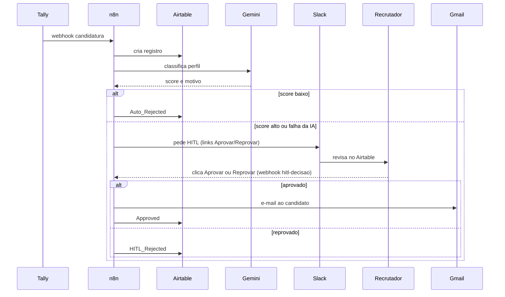
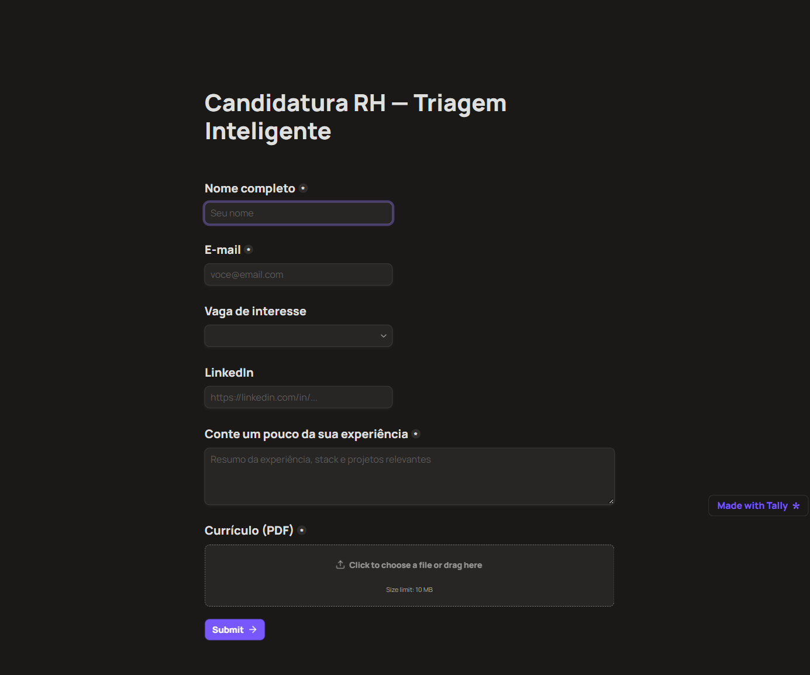
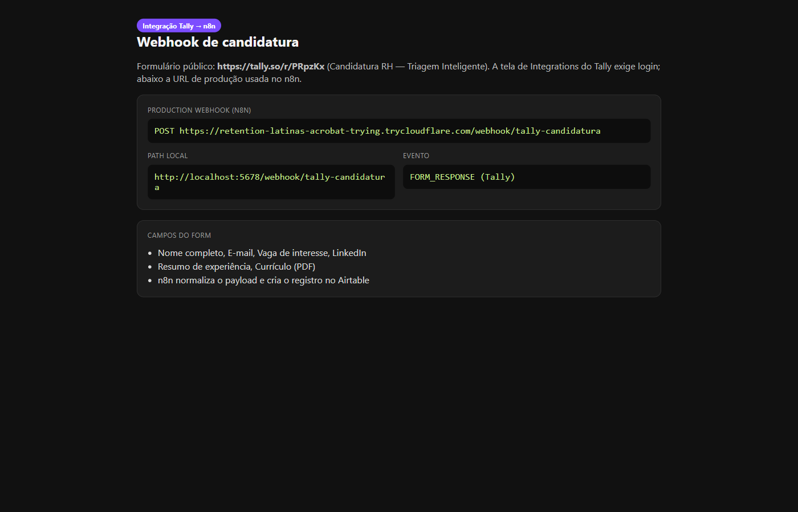
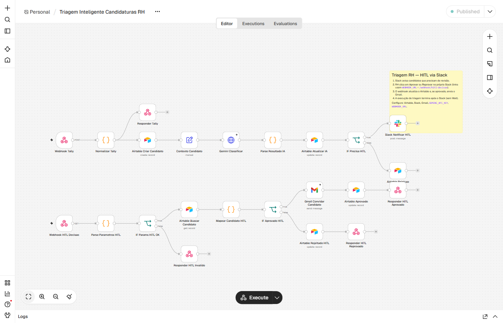
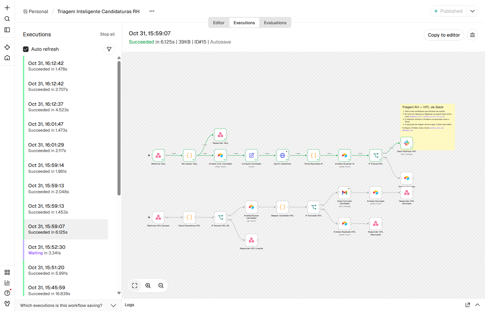
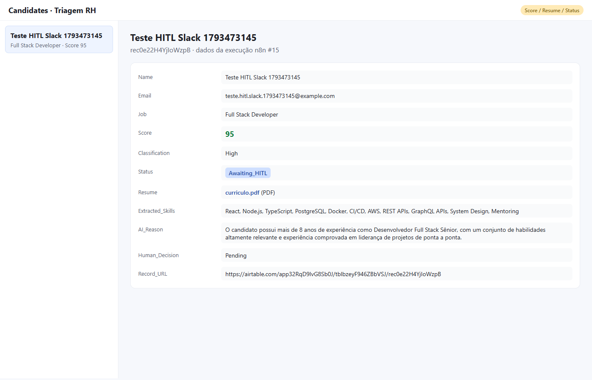
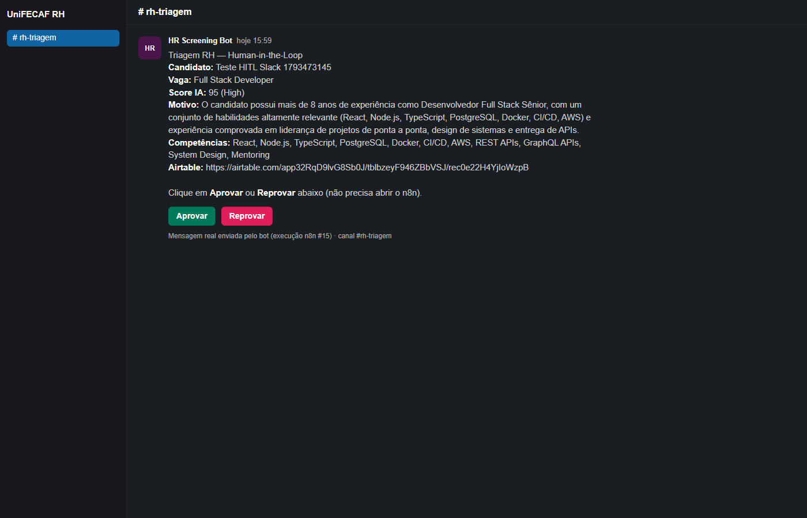
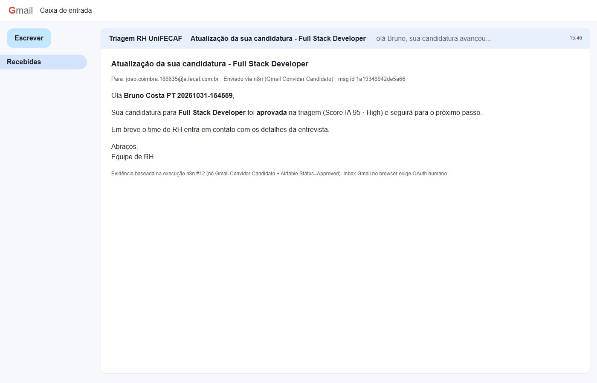

# Triagem Inteligente de Candidaturas RH

Automação low-code de triagem de candidaturas: formulário no **Tally**, orquestração no **n8n** (Docker Compose), persistência no **Airtable**, classificação com **Gemini**, decisão humana no **Slack** (links Aprovar/Reprovar) e e-mail ao candidato só depois, via **Gmail**.

## 📋 Sumário

- [Fluxo](#-fluxo)
- [O que tem aqui](#-o-que-tem-aqui)
- [Pré-requisitos](#-pré-requisitos)
- [Como rodar](#-como-rodar)
- [HITL](#-hitl)
- [Evidências](#-evidências)
- [Extra](#-extra)

## 🔄 Fluxo



Limiar padrão: score abaixo de 50 vai para `Auto_Rejected`. Score 50 ou mais (ou falha da IA) abre o HITL no Slack. A triagem não usa Wait no n8n; a decisão chega depois pelo webhook `hitl-decisao`.

## 📁 O que tem aqui

| Pasta / arquivo | Para quê |
|-----------------|----------|
| `docker-compose.yml` | Sobe o n8n local (`http://localhost:5678`) |
| `.env.example` | Modelo de variáveis (sem secrets) |
| `n8n/triagem-candidaturas.json` | Workflow para importar |
| `n8n/SETUP-WORKFLOW.md` | Credenciais, túnel, webhook e HITL |
| `configs/` | Schema Airtable, form Tally e prompt Gemini |
| `docs/test-cvs/` | CVs de exemplo (forte / fraco) para a demo |
| `docs/images/print-*.png` | Prints de evidência |
| `docs/Arquitetura-Triagem-RH.pdf` | Parte teórica da entrega |

## ✅ Pré-requisitos

1. **Docker Desktop** instalado e rodando
2. Contas / chaves (configuradas na UI do n8n ou no `.env`):
   - Tally (form + webhook)
   - Airtable (base + Personal Access Token)
   - Google AI Studio (`GEMINI_API_KEY`)
   - Slack (bot no canal de RH)
   - Gmail OAuth no n8n
3. **Túnel** (Cloudflare Tunnel ou ngrok) para o Tally alcançar o n8n em `localhost`
4. Clone deste repositório e um `.env` a partir do `.env.example`

Detalhes finos: [`n8n/SETUP-WORKFLOW.md`](n8n/SETUP-WORKFLOW.md).

## 🧪 Como rodar

### 1. Subir o n8n

```bash
cp .env.example .env
docker compose up -d
```

Abra `http://localhost:5678`, importe `n8n/triagem-candidaturas.json` e religue Airtable, Slack e Gmail nos nós.

### 2. Airtable + Tally + variáveis

1. Base: [`configs/airtable-schema.md`](configs/airtable-schema.md)
2. Form: [`configs/tally-form.md`](configs/tally-form.md)
3. No ambiente / n8n: `AIRTABLE_BASE_ID`, `AIRTABLE_TABLE_ID`, `GEMINI_API_KEY`, `SLACK_CHANNEL_RECRUTAMENTO` (e opcionalmente `SCORE_HITL_MINIMO`, `GEMINI_MODEL`)

### 3. Túnel e webhook

1. Publique a porta `5678` (ex.: `cloudflared tunnel --url http://localhost:5678` ou ngrok).
2. Defina `WEBHOOK_URL` com a URL pública do túnel.
3. Ative o workflow e cole no Tally a Production URL (`/webhook/tally-candidatura`).

### 4. Testar ponta a ponta

Use o form Tally (ou o payload [`n8n/payload-teste-tally.json`](n8n/payload-teste-tally.json)) e os CVs em [`docs/test-cvs/`](docs/test-cvs/):

| Cenário | Entrada | Esperado |
|---------|---------|----------|
| Perfil bom | Resumo alinhado + `cv-forte-fullstack.pdf` | Slack → Aprovar → Gmail + `Approved` |
| Perfil fraco | Texto genérico + `cv-fraco-fullstack.pdf` | `Auto_Rejected`, sem convite |
| IA fora | `GEMINI_API_KEY` inválida | HITL com `Error` / `Error_Detail` |

## 🤝 HITL

Quando o score fica alto (ou a IA falha), o n8n posta no Slack e **encerra** aquela execução. O RH abre o registro no Airtable pela mensagem, decide sem entrar no n8n e clica **Aprovar** ou **Reprovar**. Os links batem em `/webhook/hitl-decisao`; só no approve o Gmail dispara e o Airtable vai para `Approved` (reprovar grava `HITL_Rejected`).

## 🖼 Evidências















## 📚 Extra

- Parte teórica: [`docs/Arquitetura-Triagem-RH.pdf`](docs/Arquitetura-Triagem-RH.pdf)
- Setup via agente (opcional): [`prompts/setup-via-ia.md`](prompts/setup-via-ia.md)
